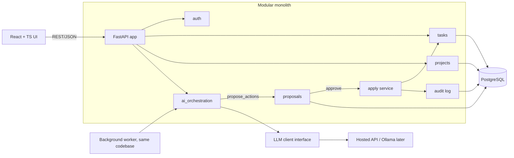

# TaskFlow AI — Project Plan

- **Status:** Draft v1, generated on explicit user request (2026-10-30)
- **Sources:** `CLAUDE.md`, `architecture/decisions/ADR-001` to `ADR-004`
- **Caveat:** All four ADRs are still marked *Proposed*, and three have open questions. This plan builds on their provisional decisions. Anything that depends on an unresolved question is tagged **[OPEN]** and listed in section 9. Resolve those before starting the phase that depends on them.

## 1. Goal

TaskFlow AI is a task-management product with a safe AI layer. The AI proposes changes (capture, breakdown, prioritization, planning) and the user approves them. Deterministic code performs every write.

## 2. Approved-so-far decisions (from ADRs)

| ADR | Decision | Status |
|---|---|---|
| 001 | Modular monolith, module boundaries enforced in CI (`import-linter`), background worker from the same codebase | Proposed |
| 002 | PostgreSQL + SQLAlchemy + Alembic, JSONB for LLM payloads, Docker Compose, same engine in dev and prod | Proposed, **[OPEN]** single-user local vs multi-user hosted |
| 003 | One orchestrator, deterministic workflows, single-step structured-output LLM calls, direct provider client behind an interface, no LangChain, no multi-agent | Proposed, **[OPEN]** MVP AI feature list |
| 004 | AI writes are proposals, user approves, one DB transaction with audit log, re-validation at apply time, proposal expiry | Proposed, **[OPEN]** parse-failure UX |

Stack choices not covered by an ADR (provisional, **[OPEN]**, need an ADR-005): Python + FastAPI backend, React + TypeScript frontend, REST + JSON over HTTP, Pydantic for validation, `pytest` for tests.

## 3. Scope

### MVP
- Auth and per-user data isolation **[OPEN: depends on the single-user vs multi-user answer]**
- Projects and tasks CRUD: status, priority, due date, simple recurrence, filtering and sorting
- AI proposal flow for at least one feature (the first candidate is natural-language task capture)
- Proposal review UI: diff view, approve, edit, reject
- Audit log of every applied AI change
- Structured logging, basic metrics, a regression eval set for the AI steps

### Later (not in MVP)
- Goal breakdown, prioritization, daily planning, chat over tasks (each added once its eval set exists)
- Reminders and notifications
- Auto-apply for low-risk actions with undo
- Semantic search (`pgvector`)
- Local models (Ollama) or multi-provider routing
- LangGraph agent loop, only if evals justify it
- Extraction of the AI module into a service

## 4. Architecture

### Module rules
- Modules: `auth`, `projects`, `tasks`, `proposals`, `audit`, `ai_orchestration` (`notifications` later).
- Each module owns its models and repositories and exposes a small service interface. No cross-module table reads or internal imports. CI enforces this.
- The LLM never touches the DB. It only returns structured output to `ai_orchestration`.

### Data model (initial)
- `users`
- `projects` (user_id)
- `tasks` (project_id, user_id, title, description, status, priority, due_at, recurrence, timestamps)
- `proposals` (user_id, kind, payload JSONB, status `pending|approved|rejected|expired|failed`, expires_at, model, prompt_version)
- `audit_log` (user_id, actor `user|ai`, action, entity, proposal_id, before/after JSONB, timestamp)
- `ai_runs` (raw output, validation errors, retry count, model, prompt_version, latency)

### AI flow
1. The user submits text. `ai_orchestration` builds context from allow-listed read tools (`search_tasks`).
2. One structured-output LLM call. Pydantic plus semantic checks (IDs exist and belong to the user, valid dates and enums). At most 2 retries with the validation error fed back.
3. On success, store a `pending` proposal and show it to the user. On failure, use the fallback in section 9 **[OPEN]**. Nothing is written partially.
4. On approval, the apply service re-validates, then writes the change and the audit entry in one transaction. A stale proposal is rejected.

## 5. Phases

Each phase ends with passing tests, a feature-specific plan file in `plans/`, and a git checkpoint (commit, then tag).

| Phase | Deliverable | Exit criteria |
|---|---|---|
| 0. Foundations | Repo layout, `pyproject.toml`, Docker Compose with Postgres, Alembic, CI (lint, type check, tests, `import-linter`), pre-commit hooks | CI green on an empty app; `docker compose up` works |
| 1. Core domain | `auth`, `projects`, `tasks` modules, migrations, REST endpoints, unit and integration tests against real Postgres | CRUD and isolation tests pass; boundary check passes |
| 2. Frontend shell | React + TS app, auth, project and task views, generated API client from OpenAPI | Core flows work end to end |
| 3. Proposal and audit infrastructure | `proposals` and `audit_log` tables, apply service, expiry, stale-check, review UI | Apply is atomic (tested with injected failures); proposals expire |
| 4. AI client and first feature | LLM client interface plus fake client, natural-language capture, validation and retry, `ai_runs` logging | Eval set passes agreed thresholds; schema-failure rate tracked |
| 5. Hardening | Prompt-injection tests, rate limits, secrets handling, structured logs, metrics, error tracking | Security checklist (section 7) complete |
| 6. MVP release | Deployment config, runbook, backup and restore test | Staging deploy passes smoke tests |
| 7+. Enhancements | One AI feature at a time, each gated by its own evals | Per-feature plan |

## 6. Testing and evaluation

- **Unit:** domain logic (recurrence, validation, state transitions) with no I/O.
- **Integration:** FastAPI + real Postgres via Compose or testcontainers. No SQLite substitute (ADR-002).
- **AI tests:** the fake LLM client for deterministic tests of the orchestration, validation, and retry paths. No network in CI.
- **Evals:** a versioned dataset of inputs with expected structured outputs, run against the real model on demand and before prompt or model changes. Track schema-failure rate, semantic-validity rate, and field accuracy.
- **Adversarial:** prompt-injection cases in task text. The assertion is that no write occurs without approval.
- **Atomicity:** inject failures mid-apply and assert that neither the task change nor the audit entry persists.
- **Frontend:** component tests plus a few end-to-end tests for the proposal review flow.

## 7. Security and quality checklist

- Per-user authorization on every query. Test cross-user access explicitly.
- No LLM write access. Allow-listed tools only.
- Treat all task text and imported content as untrusted input to the model.
- Secrets in environment variables or a secret manager; never in the repo or in logs.
- Redact or limit user content in logs. Decide on retention for raw LLM outputs.
- Rate limits and per-user LLM cost caps.
- Idempotent approve endpoint (double click must not apply twice).
- Dependency scanning in CI.

## 8. Observability

- Structured JSON logs with request ID, user ID, proposal ID, and AI run ID.
- Metrics: request latency, LLM latency and cost, retry count, schema-failure rate, proposal approve/reject/expire rates.
- Error tracking (e.g. Sentry). Tracing is deferred until a worker or service split makes it useful.

## 9. Open questions (block specific phases)

1. **Single-user local vs multi-user hosted** (ADR-002). If single-user local, SQLite replaces Postgres and Phase 1 auth is dropped. Blocks Phase 0.
2. **MVP AI features** (ADR-003). Which behaviors ship first, and does any need an autonomous loop? Blocks Phase 4. This plan assumes natural-language capture only.
3. **Parse-failure UX** (ADR-004). Silent plain task, retry prompt, or raw text for manual edit. This plan suggests: quick capture never loses input, AI planning shows an explicit error. Blocks Phase 3 UI.
4. **Frontend and backend stack** (React + TS, FastAPI) has no ADR yet. Needs ADR-005.
5. **LLM provider:** hosted API vs Ollama for the MVP, including data-privacy constraints on sending task text to a third party.
6. **Deployment target** and budget, which affect Phases 0 and 6.

## 10. Harness engineering

### MVP
- `CLAUDE.md`: keep. Note that it currently holds the discovery prompt. Replace it with durable project rules (stack, commands, boundaries, "no LLM writes") before Phase 0.
- `PLAN.md`: this file, updated at each phase boundary.
- Feature plans: `plans/<phase>-<feature>.md`, written and approved before each feature.
- ADRs: `architecture/decisions/`, the source of truth for technical decisions.
- Automated tests and CI: required from Phase 0.
- Git checkpoints: one commit per verified step, a tag per phase, and short-lived feature branches.
- Hooks: formatter and lint on edit, plus a pre-commit test run.

### Later
- Skills for repeating workflows (add a module, add an eval case).
- Specialized subagents (security reviewer, eval runner) once the codebase is large enough to justify them.
- MCP servers (database inspection, issue tracker) when a concrete need appears.

## 11. Risks

| Risk | Mitigation |
|---|---|
| Building before the open questions are answered | Resolve section 9 items 1-3 before Phase 0 |
| Over-engineering (extra services, agent frameworks) | ADR-001 and ADR-003 constraints; revisit triggers are listed in the ADRs |
| LLM output quality and drift | Eval set, prompt versioning, schema-failure metric |
| Prompt injection via task text | Proposal-only writes, allow-listed tools, adversarial tests |
| Approval fatigue | Fast review UI; consider auto-apply with undo only after eval evidence |
| Module boundary erosion | `import-linter` in CI |
| Cost and latency of hosted LLM | Caps, caching of read context, small models for simple steps |
