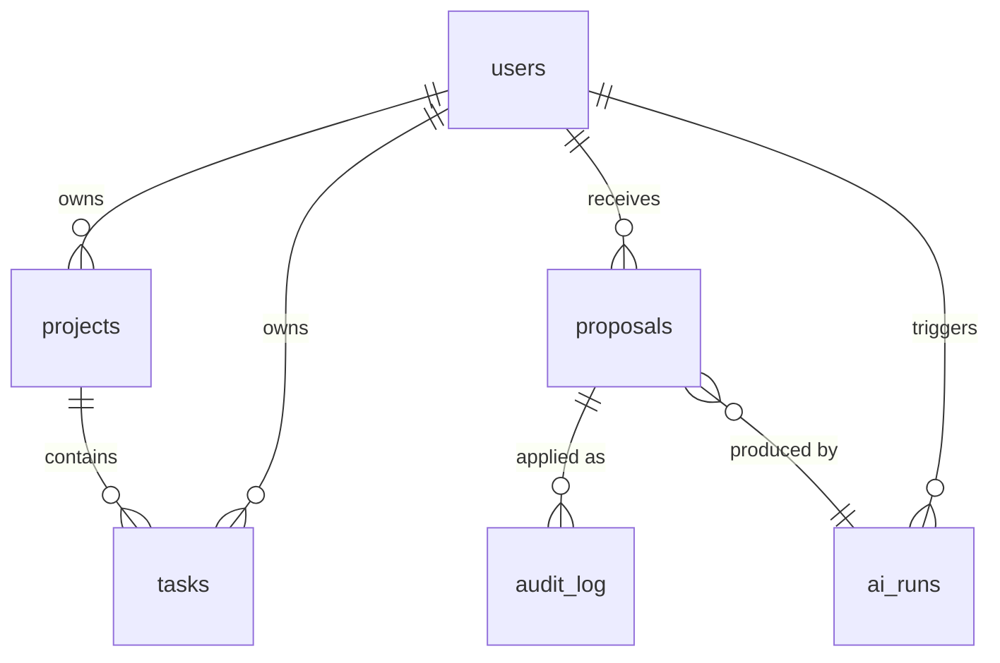

# 01 — Database Design

- **PLAN.md phase:** 0–1
- **Status:** Not started
- **Blocked by:** PLAN.md open question 1 (ADR-002 is provisional on Postgres)

## 1. Objective and scope
Define the PostgreSQL schema, conventions and migration workflow for all MVP modules.
**In scope:** tables, constraints, indexes, migration rules, test DB strategy.
**Out of scope:** goals and analytics tables (plans 05 and 06 add their own migrations).

## 2. Functional requirements
- Every user-owned row carries `user_id`, and every query filters on it.
- Applying an AI proposal and writing its audit entry happen in one transaction.
- All AI payloads (proposals, runs) are stored as JSONB and keep their model and prompt version.
- Soft delete for tasks (`deleted_at`) so audit entries stay resolvable.

## 3. Technical design

Conventions: UUID v7 primary keys, `timestamptz` everywhere in UTC, `created_at`/`updated_at` on all tables, enums as `text` with `CHECK` constraints (cheaper to migrate than native enums), SQLAlchemy 2.x typed models, one Alembic revision per change.

## 4. Component interactions
Each module owns its tables and its repository. Cross-module access goes through service interfaces. Foreign keys across modules are allowed at the DB level; imports across modules are not.

## 5. API contracts
None. The schema is exposed only through module services.

## 6. Database changes
| Table | Key columns | Constraints / indexes |
|---|---|---|
| `users` | id, email, password_hash | unique(email) |
| `projects` | id, user_id, name, archived_at | idx(user_id) |
| `tasks` | id, user_id, project_id, title, description, status, priority, due_at, recurrence (JSONB), deleted_at | CHECK status in (`todo`,`in_progress`,`done`), CHECK priority 1–4, idx(user_id, status, due_at) |
| `proposals` | id, user_id, kind, payload (JSONB), status, expires_at, ai_run_id, decided_at | CHECK status in (`pending`,`approved`,`rejected`,`expired`,`failed`), partial idx on `status='pending'` |
| `audit_log` | id, user_id, actor (`user`/`ai`), action, entity_type, entity_id, proposal_id, before, after (JSONB) | idx(user_id, created_at), append-only (no UPDATE/DELETE grants) |
| `ai_runs` | id, user_id, feature, model, prompt_version, raw_output, validation_errors, retry_count, latency_ms | idx(user_id, created_at) |

## 7. Implementation subtasks
1. Base model mixins (id, timestamps) and session/transaction helpers.
2. Migrations for `users`, `projects`, `tasks`.
3. Migrations for `proposals`, `audit_log`, `ai_runs`.
4. Revoke UPDATE/DELETE on `audit_log` for the app role.
5. Test fixtures: per-test transaction rollback on real Postgres.
6. Migration policy doc: expand/contract, no destructive change in a single release.

## 8. Failure scenarios
- Concurrent approval of one proposal: guarded by `SELECT … FOR UPDATE` on the proposal row.
- Migration fails midway: Postgres transactional DDL rolls it back.
- Long retention of `ai_runs.raw_output` (may contain user text): add a retention job in plan 10.

## 9. Testing strategy
Constraint tests (invalid status or priority rejected), upgrade-from-scratch and upgrade/downgrade round trip in CI, a test that `audit_log` rejects UPDATE/DELETE, and a concurrency test on proposal locking.

## 10. Acceptance criteria
- [ ] `alembic upgrade head` on an empty DB works; `alembic check` shows no drift.
- [ ] All constraints above are enforced by the DB, not only by the app.
- [ ] Audit log is append-only for the app role.

## 11. Dependencies and completion status
- Depends on: 00.
- Unblocks: 02, 03, 07.
- Completion: 0%.
