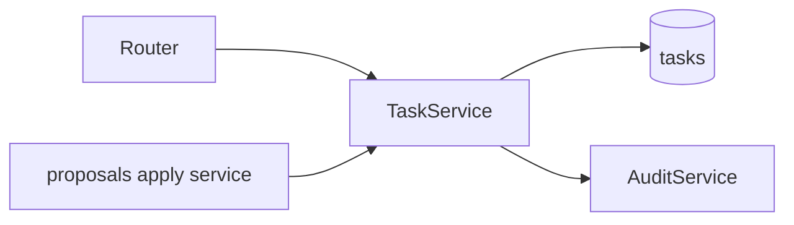

# 03 — Task Management

- **PLAN.md phase:** 1
- **Status:** Not started
- **Blocked by:** none beyond 01 and 02

## 1. Objective and scope
Deterministic CRUD and query logic for projects and tasks. This is the only code allowed to write task data, including when applying approved AI proposals.
**In scope:** projects, tasks, status transitions, priority, due dates, simple recurrence, filtering, sorting, soft delete.
**Out of scope:** subtasks hierarchy, tags, attachments, collaboration (future).

## 2. Functional requirements
- Create, read, update, soft-delete tasks and projects.
- Task fields: title (1–200 chars), description, status, priority 1–4, due date, recurrence.
- Status transitions: `todo → in_progress → done`, and `done → todo` (reopen). Others rejected.
- Completing a recurring task creates the next occurrence in the same transaction.
- List with filters (project, status, priority, due range, text), sorting, cursor pagination.
- Every write emits an audit entry (`actor=user` for direct edits).

## 3. Technical design
- `tasks` module: `service.py` (public), `repository.py`, `models.py`, `schemas.py`, `recurrence.py` (pure functions).
- Recurrence: restricted rule set (daily, weekly on days, monthly on day, every N days), stored as JSONB, computed in the user's timezone **[OPEN: store a timezone per user]**.
- Service exposes the methods the apply service in plan 07 calls: `create_task`, `update_task`, `search_tasks`. The same code path serves the UI and approved proposals.
- Optimistic concurrency: `version` integer on tasks; updates must send the expected version.

## 4. Component interactions

## 5. API contracts
| Method | Path | Notes |
|---|---|---|
| GET/POST | `/api/v1/projects` | list, create |
| PATCH/DELETE | `/api/v1/projects/{id}` | rename, archive |
| GET | `/api/v1/tasks` | query: `project_id, status, priority, due_before, due_after, q, sort, limit, cursor` |
| POST | `/api/v1/tasks` | `{title, project_id?, description?, priority?, due_at?, recurrence?}` → 201 |
| GET | `/api/v1/tasks/{id}` | |
| PATCH | `/api/v1/tasks/{id}` | partial update plus `version`; 409 on mismatch |
| POST | `/api/v1/tasks/{id}/complete` | handles recurrence; idempotent |
| DELETE | `/api/v1/tasks/{id}` | soft delete, 204 |

## 6. Database changes
Uses `projects` and `tasks` from plan 01. Adds `tasks.version` and a trigram or full-text index on `title` and `description` for `q`.

## 7. Implementation subtasks
1. Models, schemas and repositories.
2. Status transition rules (pure function).
3. Recurrence engine and tests, including DST and month-end edges.
4. Service layer with audit calls.
5. Routers and filter/sort/pagination.
6. Optimistic concurrency handling.
7. Search index migration.

## 8. Failure scenarios
- Two tabs edit one task: second gets 409 with the current version.
- Invalid transition (for example `done → in_progress`): 422 with the allowed transitions.
- Recurrence on 31st in a 30-day month: clamp to the last day, documented and tested.
- Audit write fails: whole transaction rolls back.

## 9. Testing strategy
Property-based tests for recurrence (Hypothesis), table-driven tests for transitions, integration tests for every endpoint, cross-user isolation tests, atomicity test with an injected audit failure.

## 10. Acceptance criteria
- [ ] All endpoints above work and are documented in OpenAPI.
- [ ] Recurrence edge cases pass.
- [ ] Every write produces exactly one audit entry.
- [ ] 409 on stale version.

## 11. Dependencies and completion status
- Depends on: 01, 02. Audit service (small, built here).
- Unblocks: 04, 05, 06, 07.
- Completion: 0%.
