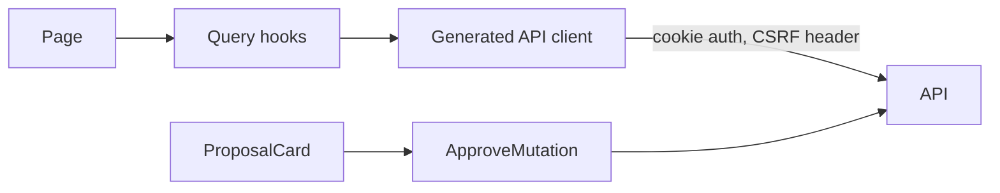

# 04 — Frontend Dashboard

- **PLAN.md phase:** 2 (and the proposal review UI in phase 3)
- **Status:** Not started
- **Blocked by:** PLAN.md open question 4 (React + TS needs ADR-005)

## 1. Objective and scope
A web UI for managing tasks and reviewing AI proposals.
**In scope:** auth screens, project/task views, task editor, quick-capture input, proposal review (diff, approve, edit, reject), error and loading states.
**Out of scope:** analytics charts (plan 06), goals UI (plan 05), mobile app, offline mode.

## 2. Functional requirements
- Sign in/out; protected routes.
- Task list with filters and sort; project sidebar; create/edit/complete/delete.
- Quick-capture box: free text submitted to the AI planner (plan 07), with a plain "add as task" option.
- Proposal inbox: each pending proposal shows a before/after diff; the user can approve, edit then approve, or reject.
- Clear display of expired, failed and stale proposals.
- Keyboard-accessible, WCAG AA basics.

## 3. Technical design
- React 18 + TypeScript (strict), Vite, React Router.
- Server state: TanStack Query. Local UI state: React state; no global store at the start.
- API client generated from `openapi.json` (`openapi-typescript` + thin fetch wrapper) so types cannot drift.
- Forms: React Hook Form + Zod, mirroring server validation.
- UI components: a small headless library (Radix) plus own styling; avoid a heavy design system.
- Structure: `src/features/{auth,tasks,projects,proposals}`, `src/shared`.

## 4. Component interactions

Mutations invalidate affected queries. Approve/reject buttons send an `Idempotency-Key` and disable while pending.

## 5. API contracts
Consumes plans 02, 03 and 07. No new endpoints. The client treats the error envelope as the single error type and shows `request_id` in a "copy details" action.

## 6. Database changes
None.

## 7. Implementation subtasks
1. Vite + TS + lint/format + test setup; CI job.
2. Generated client and fetch wrapper (CSRF, error mapping, 401 redirect).
3. Auth screens and route guards.
4. Task list, filters, editor, completion.
5. Project sidebar.
6. Quick-capture component.
7. Proposal inbox and diff view (after plan 07 API exists).
8. Accessibility pass and empty/error/loading states.

## 8. Failure scenarios
- Session expires mid-use: 401 redirects to login and preserves the draft text.
- 409 on edit: show the conflict and offer to reload the latest version.
- Approving a stale/expired proposal: show the reason; refresh the list.
- Network failure on quick capture: keep the input in the box; never lose typed text.

## 9. Testing strategy
Vitest + Testing Library for components, MSW for API mocks, Playwright for 3 critical flows (login, create/complete task, capture → review → approve), `axe` checks on main screens.

## 10. Acceptance criteria
- [ ] All MVP flows work against the real API in Playwright.
- [ ] No hand-written API types; build fails if OpenAPI changes break the client.
- [ ] Axe reports no critical violations.
- [ ] Typed input is never lost on error.

## 11. Dependencies and completion status
- Depends on: 02, 03 (shell); 07 (proposal UI).
- Unblocks: MVP release.
- Completion: 0%.
