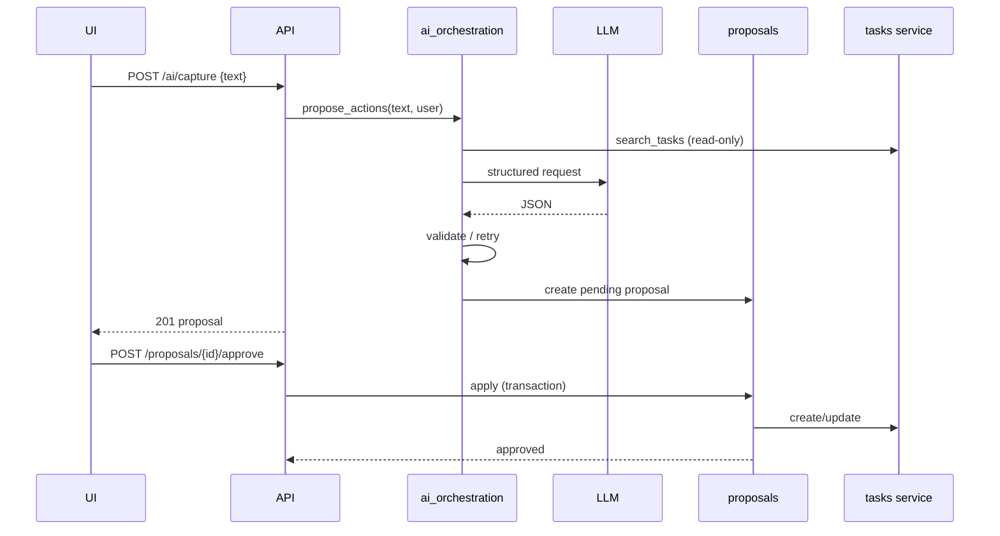

# 07 — AI Task Planner

- **PLAN.md phase:** 3–4
- **Status:** Not started
- **Blocked by:** PLAN.md open questions 2 (MVP AI features), 3 (parse-failure UX), 5 (LLM provider and privacy)

## 1. Objective and scope
The proposal-based AI feature: turn free text into proposed task changes that the user reviews before anything is written (ADR-003, ADR-004).
**MVP feature:** natural-language capture ("call the dentist Friday, high priority" → task). **[OPEN]** Others (goal breakdown, prioritization, daily planning, chat) follow one at a time after the MVP, each with its own eval set.
**Out of scope:** autonomous loops, auto-apply.

## 2. Functional requirements
- Submit text → receive a pending proposal (possibly several actions) or a clear failure.
- Review: approve, edit-then-approve, reject.
- Approval applies the actions through the task service in one transaction with audit entries.
- Proposals expire (default 24 h) and are re-validated at apply time; stale ones are rejected.
- Failure behavior **[OPEN]**: proposed default is that quick capture falls back to showing the raw text for manual edit and never loses input; explicit planning shows an error.

## 3. Technical design
- Proposal kinds: `create_task`, `update_task` (more later). Payload is a list of typed actions validated by Pydantic discriminated unions.
- Planner pipeline (deterministic wrapper around one LLM call):
  1. Build context: current date and timezone, project names, a bounded set of relevant tasks via `search_tasks`.
  2. Call the LLM through the `LLMClient` interface with a JSON-schema response format.
  3. Validate schema, then semantic checks (referenced IDs exist and belong to the user, dates parse and are plausible, enums valid).
  4. On failure retry up to 2 times with the validation error appended; then fall back.
  5. Persist `ai_runs` and the `proposals` row.
- Apply service: lock proposal row → check `pending` and not expired → re-validate against current data → call task service for each action → write audit rows → mark `approved`. All in one transaction; any failure marks the proposal `failed` and writes nothing else.
- User text is passed as data in a delimited block; the system prompt states it is untrusted. Defense is structural: the model has no write tools.

## 4. Component interactions

## 5. API contracts
| Method | Path | Body → Response |
|---|---|---|
| POST | `/api/v1/ai/capture` | `{text}` → 201 `Proposal` or 422 `{error.code: "ai_parse_failed", raw_text}` |
| GET | `/api/v1/proposals?status=pending` | list |
| GET | `/api/v1/proposals/{id}` | detail with actions and before/after diff |
| PATCH | `/api/v1/proposals/{id}` | edit actions before approval (re-validated) |
| POST | `/api/v1/proposals/{id}/approve` | idempotent → 200, 409 if stale, 410 if expired |
| POST | `/api/v1/proposals/{id}/reject` | → 204 |

`Proposal`: `{id, kind, status, actions[], expires_at, model, prompt_version}`.

## 6. Database changes
Uses `proposals`, `ai_runs`, `audit_log` from plan 01. Adds a periodic job (same codebase worker or cron-style task) that marks expired proposals.

## 7. Implementation subtasks
1. `LLMClient` interface, fake client, and one real provider adapter.
2. Action schemas and semantic validators.
3. Prompt template, versioned in the repo (`prompts/capture/v1.md`).
4. Planner pipeline with retry and fallback.
5. Proposal service, apply service, expiry job.
6. Routes and idempotency.
7. Rate limits and per-user cost caps.
8. Review UI (plan 04).

## 8. Failure scenarios
| Scenario | Behavior |
|---|---|
| Provider timeout or 5xx | One retry with backoff, then `ai_unavailable`; raw text preserved for manual add |
| Malformed or invalid JSON | Retry with error feedback (max 2), then fallback |
| Referenced task ID missing or foreign | Semantic check fails, retry, then fallback |
| Data changed between proposal and approval | Approve returns 409; proposal marked `failed` with reason |
| Double-click approve | Idempotent; second call returns the first result |
| Prompt injection in text | No write tools exist; proposal still requires approval; adversarial evals |
| Cost cap reached | 429 with message; manual task creation still works |

## 9. Testing strategy
Unit tests with the fake client for each pipeline branch; atomicity tests for apply; adversarial injection suite; evals per plan 09; contract tests for the real adapter run on demand, not in CI.

## 10. Acceptance criteria
- [ ] The LLM never writes to the DB (verified by code structure and a test that the planner has no write dependency).
- [ ] Apply is atomic with its audit entry.
- [ ] Eval thresholds met (initial target: ≥95% schema-valid after retries, ≥90% field accuracy on the capture set; confirm in plan 09).
- [ ] Stale and expired proposals are rejected.
- [ ] Raw text is never lost on failure.

## 11. Dependencies and completion status
- Depends on: 01, 02, 03, 08 (orchestrator internals).
- Unblocks: 04 (review UI), 05, 06 summary.
- Completion: 0%.
