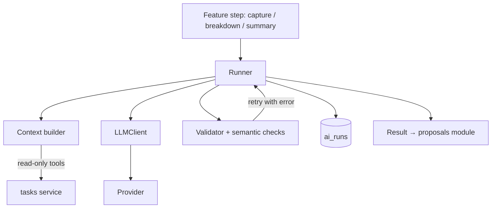

# 08 — Agent Orchestration

- **PLAN.md phase:** 4 (internals of the `ai_orchestration` module)
- **Status:** Not started
- **Blocked by:** PLAN.md open question 2

## 1. Objective and scope
Define the AI orchestration layer that plan 07 and later AI features run on.
**Important scope note:** ADR-003 decides on **one orchestrator and no multi-agent system for the MVP**. This plan therefore builds the shared infrastructure (client, tools, validation, retry, tracing) and defines when an agent loop or multiple agents would be justified. It does not build them.
**In scope:** LLM client interface, tool registry and permissions, validation/retry engine, prompt versioning, run logging, context management.
**Out of scope:** LangGraph, LangChain, multi-agent routing, long-term memory.

## 2. Functional requirements
- Provider-agnostic client with structured output, timeouts, and a fake implementation for tests.
- Tool registry where each tool declares: name, input schema, `read_only` flag, required permission.
- Write tools are not callable by the model; they only emit proposal actions.
- Every run records model, prompt version, inputs hash, raw output, validation errors, retries, latency, token usage.
- Bounded context building per feature.

## 3. Technical design
- Layout: `ai_orchestration/{client.py, providers/, tools.py, validation.py, runner.py, prompts/, context.py, public.py}`. Only `public.py` is importable by other modules (for example `propose_actions`, `summarize`).
- `runner.run_step(step_spec, input) -> Result`: render prompt → call client → validate → retry (max 2) → return `Result(ok, value | error, run_id)`.
- **Capability classification (decision table):**

| Capability | Mechanism |
|---|---|
| CRUD, filtering, recurrence, permissions, applying changes | Deterministic code |
| Text → structured task | Single LLM step |
| Goal → subtasks | Single LLM step |
| Prioritization / daily plan | Single LLM step over a bounded task set |
| Summaries, Q&A over tasks | Single LLM step, read-only |
| Open-ended multi-step assistant | Not in MVP; agent loop only if evals show single steps fail |

- Context: stateless per request. Context = system prompt + current date/timezone + bounded retrieved tasks (cap by count and tokens). No persistent conversation memory in the MVP; if chat is added, store a short rolling window per session.
- **Triggers to revisit (from ADR-003):** a feature needs iterative tool use, evals show a single step failing where a loop succeeds, a component must read untrusted external content in isolation from the one holding write access, or real parallelism is needed. Then adopt LangGraph for an explicit state machine, via a new ADR.

## 4. Component interactions


## 5. API contracts
Internal Python interfaces only:
```python
class LLMClient(Protocol):
    def complete(self, *, system: str, user: str, schema: type[BaseModel],
                 timeout_s: float) -> LLMResponse: ...

def propose_actions(user_id: UUID, text: str) -> Result[ProposalDraft]: ...
```
HTTP surface lives in plan 07.

## 6. Database changes
Uses `ai_runs` from plan 01. Optionally add `token_usage` and `cost_micros` columns for cost caps.

## 7. Implementation subtasks
1. `LLMClient` protocol, fake client, first provider adapter.
2. Tool registry with read-only enforcement and tests.
3. Runner with retry and error feedback.
4. Prompt loader with version stamps.
5. Context builder with token budgets.
6. `ai_runs` logging with redaction rules.
7. Cost and rate accounting.
8. Document the agent-loop adoption criteria in an ADR stub.

## 8. Failure scenarios
- Provider outage: circuit breaker opens after N consecutive failures; features degrade to manual paths.
- Token budget exceeded in context: truncate by relevance and record that truncation happened.
- Model returns a tool name not in the registry: reject, count as validation failure.
- Prompt version mismatch between proposal and apply: apply does not depend on the prompt, only on stored actions.

## 9. Testing strategy
Fake-client tests for runner branches; registry tests proving no write tool is exposed; import-linter contract that `ai_orchestration` cannot import `tasks.repository` or any write method; provider adapter contract tests (on demand).

## 10. Acceptance criteria
- [ ] A new single-step feature can be added with a prompt, a schema and a validator, without touching the runner.
- [ ] No write path from `ai_orchestration` to task tables (enforced in CI).
- [ ] Every run is logged with prompt version and retry count.
- [ ] Swapping the provider requires only a new adapter.

## 11. Dependencies and completion status
- Depends on: 00, 01, 03 (read-only search).
- Unblocks: 07, and 05/06 AI steps.
- Completion: 0%.
