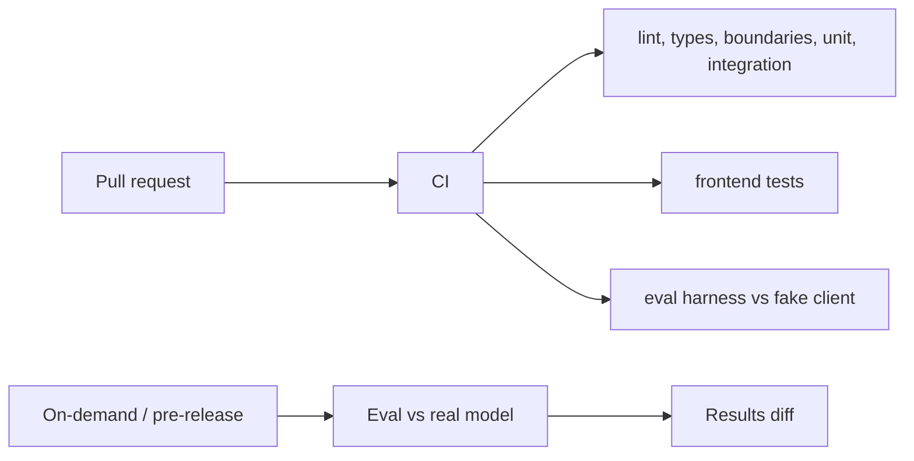

# 09 — Testing and Evaluation

- **PLAN.md phase:** cross-cutting, starts in phase 0
- **Status:** Not started
- **Blocked by:** none

## 1. Objective and scope
Define the test pyramid, CI gates, and the AI evaluation framework so quality is measurable from the first feature.
**In scope:** unit, integration, end-to-end, security, AI evals, CI gates, test data.
**Out of scope:** load-testing infrastructure beyond targeted checks.

## 2. Functional requirements
- All non-AI tests run offline and deterministically in CI.
- AI behavior is measured against a versioned dataset with explicit thresholds.
- A prompt or model change cannot merge without an eval run attached.
- Regressions found in production become new eval or test cases.

## 3. Technical design
| Layer | Tooling | What it covers |
|---|---|---|
| Unit | pytest, Hypothesis | Domain logic, recurrence, validators |
| Integration | pytest + real Postgres, httpx `AsyncClient` | Routers, services, migrations, constraints, atomicity |
| Frontend | Vitest, Testing Library, MSW | Components and hooks |
| E2E | Playwright | Login, task CRUD, capture → approve |
| Security | pytest cross-user matrix, injection suite, `pip-audit`, `npm audit` | Isolation, injection, dependencies |
| AI evals | pytest marker `eval`, JSONL datasets | Schema validity, field accuracy, semantic validity, injection resistance |

**Eval design**
- Dataset: `tests/evals/datasets/capture_v1.jsonl` of `{input, context, expected}`; start with 50 hand-written cases covering dates, priorities, ambiguity, empty input, multilingual input and injection attempts. Grow it from real failures.
- Metrics: schema-valid rate (after retries), semantic-valid rate, per-field exact match, fallback rate, retry rate, latency, cost per case.
- Scoring: deterministic comparison where possible (dates, enums); an LLM judge only for free-text fields, calibrated against a human-labelled subset.
- Runs: on demand and before prompt/model changes, against the real model; results stored in `tests/evals/results/` and diffed against the previous run. CI runs the eval harness itself against the fake client to keep the harness working.

## 4. Component interactions

## 5. API contracts
CLI: `make test`, `make test-e2e`, `make eval FEATURE=capture MODEL=<id>`, which prints the metrics table and exits non-zero below threshold.

## 6. Database changes
None. Test DB is created from migrations on each CI run; per-test transaction rollback.

## 7. Implementation subtasks
1. Fixtures: DB session, authenticated client, factories.
2. Cross-user isolation matrix generator over all routers.
3. Atomicity and concurrency test helpers (failure injection).
4. Eval runner, dataset schema, scorer, results diff.
5. Initial capture dataset and thresholds.
6. Playwright setup and CI job.
7. Dependency audit job; coverage reporting.
8. Flaky-test policy: quarantine with an issue, fix within a week.

## 8. Failure scenarios
- Flaky tests: no retries in CI by default; quarantine process above.
- Eval noise from model nondeterminism: temperature 0 where supported, run each case 3× for gating runs, compare against a threshold with a margin.
- Dataset leakage into prompts: examples in prompts must come from a separate set than eval cases.
- LLM judge drift: keep the human-labelled calibration set and re-check agreement when the judge model changes.

## 9. Testing strategy
Meta-tests: the harness fails on a deliberately bad fixture; the isolation matrix fails if a router is missing from it.

## 10. Acceptance criteria
- [ ] CI blocks merge on lint, types, boundaries, tests.
- [ ] Coverage target: 85% on domain and service layers (not a goal for glue code).
- [ ] Initial eval thresholds set and documented (starting point: ≥95% schema-valid, ≥90% field accuracy, 0 writes without approval in injection cases).
- [ ] Every router is covered by the isolation matrix.

## 11. Dependencies and completion status
- Depends on: 00 (CI), 01 (DB), 07/08 (eval targets).
- Unblocks: confidence in every other plan.
- Completion: 0%.
