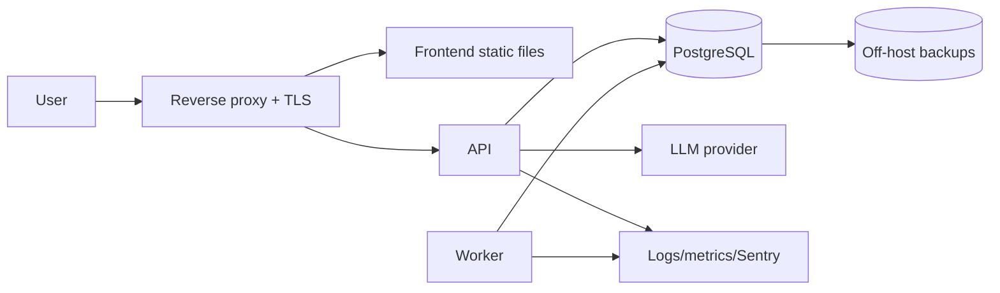

# 10 — Deployment

- **PLAN.md phase:** 5–6
- **Status:** Not started
- **Blocked by:** PLAN.md open question 6 (deployment target and budget), and question 1 (hosted vs local)

## 1. Objective and scope
Run the MVP reliably in one environment beyond a developer laptop, with safe config, backups, observability and a release procedure.
**In scope:** container images, environments, secrets, migrations on deploy, backups, logging/metrics/error tracking, runbook.
**Out of scope:** Kubernetes, multi-region, autoscaling.

## 2. Functional requirements
- Reproducible build of backend and frontend images from CI.
- Staging and production share one configuration shape, differing only in values.
- Database migrations run automatically and safely on release.
- Backups with a tested restore.
- Health checks, structured logs, key metrics and alerts.

## 3. Technical design
- Recommended start (confirm against the open question): a single VM or a managed container service, with a managed PostgreSQL if the budget allows; otherwise Compose on one host with scheduled `pg_dump` to off-host storage.
- Images: multi-stage Dockerfile for the backend (non-root user, pinned base image), static frontend served by a reverse proxy (Caddy or nginx) that also terminates TLS.
- Processes from one codebase: `api`, `worker` (expiry job, later background AI work).
- Config via environment variables; secrets from the platform secret store, never in images or the repo.
- Release flow: CI builds and tags image → deploy to staging → smoke tests → manual promote → run `alembic upgrade head` as a pre-start step → rolling restart. Migrations follow expand/contract so the previous app version still works during rollout.
- Observability: JSON logs to the platform collector; Prometheus-style `/metrics` or platform metrics for latency, error rate, LLM latency/cost, schema-failure rate, proposal outcomes; Sentry for errors. Alerts: error rate, readiness failures, LLM failure rate, backup age.
- Data governance: retention for `ai_runs.raw_output` (default 30 days), log redaction of task text, documented data flow to the LLM provider.

## 4. Component interactions

## 5. API contracts
Operational endpoints: `/healthz`, `/readyz`, `/metrics` (not publicly exposed). Deploy interface: `make release TAG=<x>` or a CI workflow dispatch.

## 6. Database changes
None. Adds a retention job for `ai_runs` and expired proposals. Production DB role has no DDL rights; migrations run with a separate migration role.

## 7. Implementation subtasks
1. Dockerfiles and production Compose (or platform manifests).
2. Reverse proxy config with TLS and security headers (CSP, HSTS).
3. Secrets management and config validation per environment.
4. CI release pipeline with staging smoke tests.
5. Migration step and rollback procedure.
6. Backups, restore drill, retention jobs.
7. Metrics, dashboards, alerts, Sentry.
8. Runbook: deploy, rollback, restore, rotate secrets, LLM outage.

## 8. Failure scenarios
- Bad migration: expand/contract plus staging rehearsal; rollback = redeploy previous image (schema stays compatible).
- DB loss: restore from the latest backup; target RPO 24 h and RTO 4 h for MVP, adjustable.
- LLM provider outage: AI features degrade, manual task management unaffected; alert fires.
- Leaked secret: rotation steps in the runbook.
- Disk full from logs or backups: log rotation and alert on disk usage.

## 9. Testing strategy
Staging smoke tests (login, create task, capture → approve), an actual restore drill before launch, a rollback rehearsal, container scan in CI, and a basic security-headers check.

## 10. Acceptance criteria
- [ ] Tagged release deploys to staging and production from CI.
- [ ] Restore drill succeeds and is timed.
- [ ] Alerts fire in a simulated failure.
- [ ] No secrets in images, repo or logs.
- [ ] Runbook reviewed by someone other than its author.

## 11. Dependencies and completion status
- Depends on: 00, 02, 07 (all MVP features), 09.
- Unblocks: MVP release.
- Completion: 0%.
